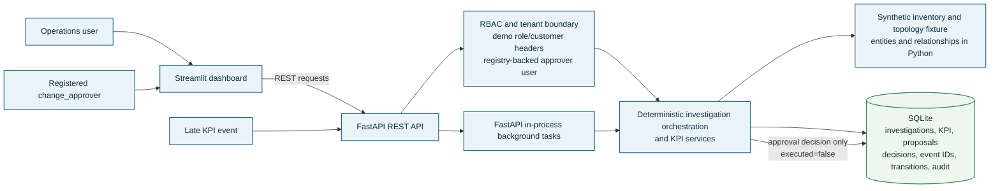
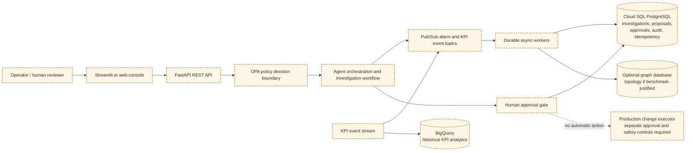

# Telecom Network Intelligence Architecture

> **Diagram precedence:** the two diagrams on this page are authoritative for implementation status. The supplemental [architecture.png](architecture.png), [design-note.docx](design-note.docx), and [submission-slides.pptx](../submission-slides.pptx) are target-architecture proposal artifacts; their Cloud Run, Pub/Sub, Cloud SQL, BigQuery, graph database, OPA, MCP and LLM components are not deployed local components.

## Implemented local prototype

Solid boundaries represent functionality present in this repository. All local data is synthetic; this system does not call production network systems.

The investigation API stores `RECEIVED` before returning, then analyzes evidence in a FastAPI background task. Tenant-scoped SQLite queries persist investigations, state transitions, KPI measurements, late event IDs, proposals, approval/rejection decisions, and audit records. The local topology engine performs bounded two-hop traversal over synthetic fixture data; it is **not** backed by a graph database. RBAC is implemented in service code; OPA is not deployed.

Change proposals start as `PENDING_HUMAN_APPROVAL`. The `change_approver` role can approve/reject only proposals belonging to the customer bound to its registered demo user ID. The decision and audit history persist, but no network action is executed and `executed` remains false.

The default SQLite file is `data/network_intelligence.sqlite3`; `NETWORK_INTELLIGENCE_DB` overrides its path. Seeded inventory currently includes only `CUST-A` and `CUST-B`.

## Proposed Google Cloud architecture

Every component in this separately labeled view is a design mapping only; it is **not implemented or deployed**. Dashed node borders distinguish proposed components from the solid-border local prototype. Cloud SQL adjacency is the conservative first target; a graph database is an optional topology-store candidate only if measured traversal needs justify it, not a claim about a specific Google-managed product.

### Component mapping

| Concern | Local implementation | Proposed cloud mapping |
| --- | --- | --- |
| Dashboard | Streamlit | Streamlit or a production web client |
| REST/API boundary | FastAPI | FastAPI service, e.g. Cloud Run |
| Agent/investigation workflow | Deterministic services plus in-process background tasks | Durable orchestration workers consuming Pub/Sub |
| Tenant authorization | Service RBAC and tenant predicates; demo identities | Verified OIDC/IAM claims plus OPA policy evaluation |
| Topology/relationships | Synthetic Python fixture; no graph database | Cloud SQL adjacency initially; optional graph store if benchmarks justify |
| Operational records | SQLite | Cloud SQL for PostgreSQL |
| Asynchronous events | FastAPI `BackgroundTasks` and HTTP KPI event endpoint | Pub/Sub topics, retry policy and dead-letter handling |
| KPI analytics | Small SQLite synthetic time series | BigQuery export and analytics |
| Human approval | Persisted decision; execution disabled | Approval service and audited workflow; executor separately gated |

No Cloud SQL, Pub/Sub, BigQuery, OPA, graph database, Cloud Run, or production executor has been configured or deployed.

## Local performance validation

Measured against the local Windows prototype with the synthetic dataset on 2026-11-10:

| Workload | Samples | Result | p50 | p95 |
| --- | ---: | ---: | ---: | ---: |
| Concurrent `POST /v1/investigations` | 100 requests, 100 workers | 100 HTTP 200; batch 9.16s | 1.4154s | 8.4078s |
| Two-hop topology lookup | 100 sequential requests | 100 HTTP 200 | 16.418ms | 28.407ms |

These are local prototype measurements on a tiny synthetic fixture, not production capacity or service-level objectives.

## Limitations

- FastAPI background tasks are process-local, not a durable queue, and are not coordinated across multiple API workers.
- SQLite is for local single-host use; no multi-instance database configuration is implemented.
- Only two customer datasets are populated; the other customer contexts are isolation probes, not full tenants.
- The approver registry is static demo authentication, not an identity provider.
- Approval records a decision only; no real or simulated network operation executes.
- Large-scale inventory/KPI assumptions, graph database behavior, OPA policies, MCP runtime, and cloud services are not validated.
